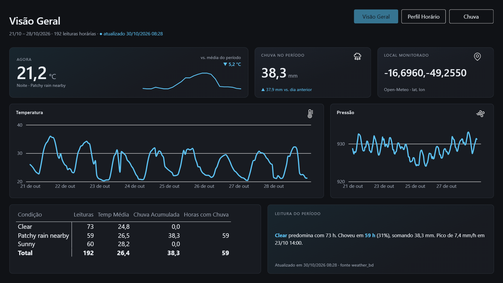
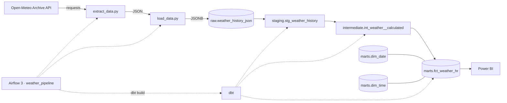

# Weather Pipeline

Pipeline de dados meteorológicos: extrai o histórico horário do **Open-Meteo**, guarda o JSON
bruto no **PostgreSQL**, transforma com **dbt** em um modelo dimensional e alimenta um
dashboard no **Power BI**.

[](https://app.powerbi.com/view?r=eyJrIjoiYjM0NjM1NDMtNzVlMS00Mjk0LWFhZmUtNWY3NzE5YjhkOWQxIiwidCI6IjY1OWNlMmI4LTA3MTQtNDE5OC04YzM4LWRjOWI2MGFhYmI1NyJ9)

**[Abrir o dashboard publicado](https://app.powerbi.com/view?r=eyJrIjoiYjM0NjM1NDMtNzVlMS00Mjk0LWFhZmUtNWY3NzE5YjhkOWQxIiwidCI6IjY1OWNlMmI4LTA3MTQtNDE5OC04YzM4LWRjOWI2MGFhYmI1NyJ9)**

## Dashboard

O painel lê o schema `marts` direto no Postgres (modo import) em três páginas:

- **Visão Geral** — temperatura da última leitura contra a média do recorte, com sparkline das
  últimas 24 h; séries de temperatura e pressão; chuva acumulada contra o total do dia anterior
  ao último dia do recorte; local monitorado e um resumo do período.
- **Perfil Horário** — picos de temperatura, umidade e vento, série horária de temperatura e
  heatmap de temperatura média por hora × dia.
- **Chuva** — acumulado, horas com chuva e percentual das horas, maior volume em uma hora,
  amplitude térmica e evolução diária.

O painel é modo import e não tem filtro de data: o recorte exibido é o da última carga importada.

## Arquitetura



O Airflow agenda uma execução diária (`0 6 * * *`, sem catchup) e roda
`extract → load → dbt build` no mesmo container. A janela padrão vai de hoje-4 a hoje-2; uma
execução manual pode receber `start_date` e `end_date` pela UI.

## Modelo de dados

| Camada | Objeto | Grão | Papel |
|---|---|---|---|
| raw | `raw.weather_history_json` | 1 linha por extração | Payload JSONB íntegro da API, append-only |
| staging | `staging.stg_weather_history` (view) | 1 hora × local | Explode os arrays horários e deduplica pela última carga |
| intermediate | `intermediate.int_weather__calculated` (view) | 1 hora × local | Chaves, variação de 1 h e flag de chuva |
| marts | `marts.fct_weather_hr` (table) | 1 hora × local | Fato com as medidas meteorológicas |
| marts | `marts.dim_date` / `marts.dim_time` (table) | 1 dia / 1 hora | Dimensões de calendário e hora |

O macro `generate_schema_name` grava cada camada no schema do próprio nome (`staging`,
`intermediate`, `marts`), sem prefixo do target.

## Decisões técnicas

- **Bruto primeiro** — o payload completo vira JSONB em `raw`, então dá para reprocessar sem
  chamar a API de novo.
- **Dedupe na staging** — `row_number()` por local/horário, ordenando por `loaded_at` e
  `ingestion_id`, garante que reexecutar a mesma janela não duplique fatos.
- **Camadas com grão explícito** — view na staging e na intermediate, table nos marts.
- **Star schema** — fato com `weather_key` e FKs `date_key` / `hour_key`, coberto por testes de
  `unique`, `not_null` e `relationships`.
- **Teste de integridade da fonte** — `tests/assert_temperature.sql` falha se os arrays horários
  tiverem tamanhos diferentes entre si.
- **Reexecução idempotente** — rodar a mesma janela de novo apenas faz a leitura mais recente
  prevalecer.

## Stack

| Camada | Tecnologia |
|---|---|
| Orquestração | Apache Airflow 3.3.1 (`airflow standalone`, LocalExecutor) |
| Transformação | dbt-core / dbt-postgres 1.11 |
| Banco | PostgreSQL 16 |
| Extração | Python + `requests` |
| Infra | Docker Compose |
| Visualização | Power BI (import) |

## Como rodar

```bash
docker compose up -d --build
```

- Airflow: <http://localhost:8080> — login `airflow` / `airflow`. A DAG `weather_pipeline` já sobe
  ativa; a primeira subida leva cerca de 1 minuto até a UI responder.
- Postgres: `localhost:5433` — banco `weather_bd` (`weather_user` / `123456`).

Disparar pela UI com `{"start_date": "2026-10-17", "end_date": "2026-10-19"}`, ou rodar um
DagRun local com a janela padrão:

```bash
docker compose exec airflow airflow dags test weather_pipeline
```

dbt manual:

```bash
docker compose exec airflow dbt build --project-dir /opt/airflow/dbt --profiles-dir /opt/airflow/dbt
```

Conferir a carga:

```bash
docker compose exec postgres psql -U weather_user -d weather_bd \
  -c "select count(*) from raw.weather_history_json;"
```

Recriar o banco do zero (apaga metastore e dados):

```bash
docker compose down -v && docker compose up -d --build
```

## Estrutura do repositório

```
.
├── weather-project/
│   ├── airflow/dags/weather_dag.py   # DAG extract → load → dbt build
│   ├── src/                          # extract_data.py e load_data.py
│   └── dbt_weather/                  # staging → intermediate → marts + testes
├── init-db/                          # schema raw e tabela de ingestão (primeiro boot)
├── config/                           # senha do simple auth manager
├── data/                             # JSONs extraídos (gitignored)
└── docs/dashboard.png                # print do dashboard usado no README
```

## Fonte dos dados

[Open-Meteo Archive API](https://open-meteo.com/en/docs/historical-weather-api), sem chave.
Local fixo em Goiânia (-16.6869, -49.2648), timezone `America/Sao_Paulo`, com as variáveis
horárias: temperatura a 2 m, umidade relativa, precipitação, pressão na superfície e vento a 10 m.
